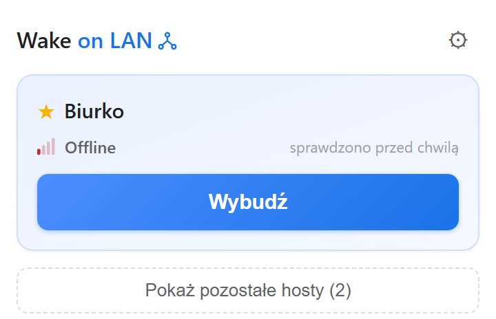
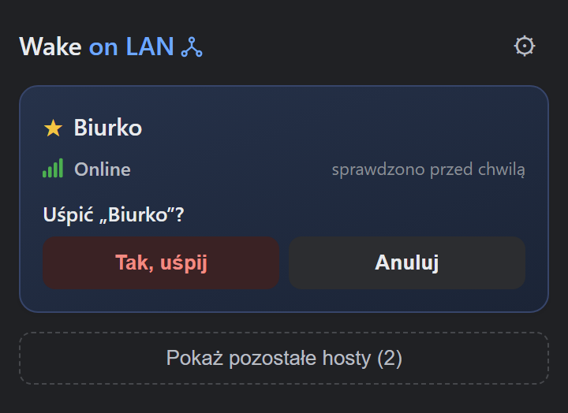
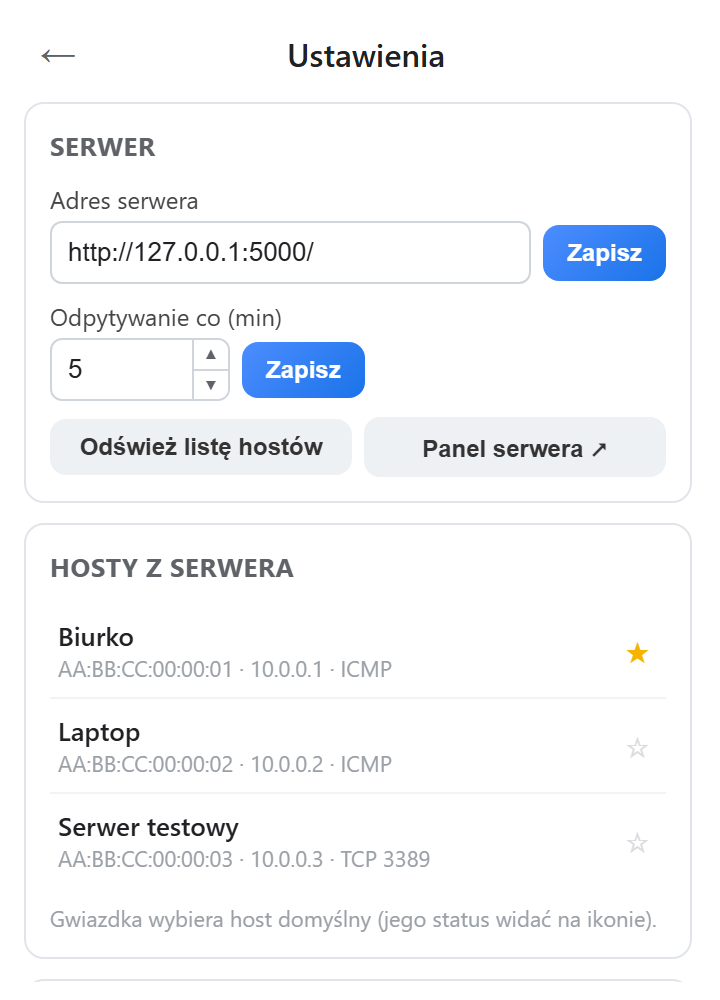

# Wake on LAN — rozszerzenie do przeglądarki

Rozszerzenie Chrome/Chromium (Manifest V3) do **wybudzania i usypiania komputerów w sieci** przez serwer [gptwol](https://github.com/Misterbabou/gptwol). Szybki dostęp z paska narzędzi: jeden klik, żeby zobaczyć, czy Twój komputer działa, i drugi, żeby go wybudzić. Stan wybranego hosta widać na samej ikonie.

> Nieoficjalne rozszerzenie, niezwiązane z autorem gptwol. Interfejs jest po polsku.

<p>
  
  
  
</p>

## Co potrafi

- **Host domyślny na wierzchu**: duży przycisk i status online/offline, odświeżany automatycznie w tle. Pozostałe hosty są pod spodem, ze statusem sprawdzanym na żądanie (klik w wiersz).
- **Status na ikonie paska narzędzi**: kolor ikony pokazuje stan hosta domyślnego, bez otwierania popupu.
- **Wybudzanie i usypianie** (Wake-on-LAN / Sleep-on-LAN) z zabezpieczeniem przed pomyłką — patrz niżej.
- **Lista hostów pochodzi z serwera**, więc cały zespół widzi to samo bez ręcznego wpisywania adresów MAC. Dodawanie i edycja hostów odbywa się w panelu serwera (przycisk **Panel serwera** w Ustawieniach).
- **Dziennik błędów** w Ustawieniach, z typem błędu i szczegółami, żeby nie zgadywać, czemu coś nie działa.
- Jasny i ciemny motyw (zgodnie z systemem).

## Wymagania

- Działająca instancja **gptwol** dostępna z Twojego komputera (LAN albo VPN). Rozszerzenie nie zawiera serwera.
- Przeglądarka oparta o Chromium z obsługą Manifest V3 (Chrome, Brave, Edge…). Rozwijane i testowane w Brave.
- Hosty muszą być już dodane w panelu gptwol — wybudzanie odbywa się po adresie MAC.

## Instalacja

Rozszerzenie nie jest (jeszcze) w sklepie, więc ładujesz je jako rozpakowane:

1. Pobierz repozytorium (`git clone` albo ZIP) i rozpakuj.
2. Otwórz `chrome://extensions` (w Brave `brave://extensions`, w Edge `edge://extensions`).
3. Włącz **Tryb dewelopera**.
4. Kliknij **Załaduj rozpakowane** i wskaż katalog z plikiem `manifest.json`.
5. Przypnij ikonę do paska narzędzi.

## Pierwsze uruchomienie

1. Kliknij ikonę rozszerzenia, potem ⚙ **Ustawienia**.
2. Wpisz adres serwera gptwol, np. `http://twoj-serwer:5000/`, i kliknij **Zapisz**.
3. Otworzy się karta z prośbą o dostęp do tego adresu — kliknij **Przyznaj dostęp** i zatwierdź okno przeglądarki. (Robi to osobna karta, bo okno zgody zamykałoby popup, zanim zdążysz odpowiedzieć.)
4. Wróć do popupu: lista hostów pobierze się sama. Gwiazdką ☆ wybierz **host domyślny** — jego status pojawi się na ikonie.

## Jak to działa na co dzień

| Stan hosta | Co pokazuje przycisk |
|---|---|
| Nie odpowiada (offline) lub nieznany | zielony **Wybudź** |
| Działa (online) | czerwony **Uśpij** — wymaga potwierdzenia |

Ikona na pasku narzędzi:

| Kolor | Znaczenie |
|---|---|
| zielony | host domyślny działa |
| czerwony | host domyślny nie odpowiada |
| szary (`?`) | brak serwera lub hostów — nic jeszcze nie sprawdzono |
| pomarańczowy (`!`) | błąd sprawdzania (np. serwer nieosiągalny) — szczegóły w dzienniku błędów |
| niebieski | stan początkowy, przed pierwszym sprawdzeniem |

Domyślnie status hosta domyślnego jest odpytywany co 5 minut (zmienisz to w Ustawieniach).

### Uwaga: przełącznik wake/sleep

Serwer gptwol ma jedną akcję, która sama decyduje: jeśli host działa, wysyła **Sleep-on-LAN (wyłączenie)**, a jeśli nie — Wake-on-LAN. Samo kliknięcie "wybudź" na działającym komputerze mogłoby go więc wyłączyć. Dlatego rozszerzenie:

- przed wysłaniem **sprawdza status** tym samym testem, którego używa serwer, i **odmawia**, jeśli wysłanie dałoby odwrotny skutek (nic wtedy nie wysyła, a widok statusu się koryguje);
- wymaga **potwierdzenia przy usypianiu**;
- po wysłaniu pokazuje to, co serwer **faktycznie** zrobił.

Usypianie działa tylko na komputerach ze skonfigurowanym [Sleep-on-LAN](https://github.com/SR-G/sleep-on-lan) — patrz dokumentacja gptwol.

## Prywatność i uprawnienia

- Rozszerzenie **nie zbiera żadnych danych** i rozmawia wyłącznie z serwerem, który sam wskażesz.
- Przy instalacji prosi tylko o `storage` i `alarms`. Dostęp do adresu serwera jest przyznawany **dopiero po wpisaniu adresu** i tylko dla tego jednego adresu (stąd w manifeście szeroki `optional_host_permissions` — zakres nie jest znany z góry, ale nic z niego nie jest przyznawane automatycznie).
- Adres serwera, interwał i host domyślny trafiają do `chrome.storage.sync` (zsynchronizują się przez Twój profil przeglądarki, jeśli masz włączoną synchronizację). Lista hostów, statusy i dziennik błędów zostają lokalnie.
- Serwer gptwol **domyślnie nie ma uwierzytelniania**. Nie wystawiaj go do internetu bez zabezpieczenia.

## Ograniczenia

- **Logowanie (`ENABLE_LOGIN`) i OIDC nie są obsługiwane.** Przy włączonym logowaniu rozszerzenie pokaże czytelny błąd; zarządzaj hostami i wysyłaj pakiety z panelu w przeglądarce.
- gptwol nie ma udokumentowanego API ani endpointu JSON. Rozszerzenie czyta listę hostów z HTML strony głównej i używa wewnętrznych endpointów, więc **po aktualizacji serwera coś może przestać działać** (zobaczysz błąd `BAD_FORMAT`). Szczegóły kontraktu: [docs/DESIGN-NOTES.md](docs/DESIGN-NOTES.md).
- Interfejs tylko po polsku.

## Rozwiązywanie problemów

Wszystkie błędy trafiają do **Ustawienia → Logi błędów**.

| Kod | Zwykle znaczy |
|---|---|
| `NETWORK_ERROR` | serwer nieosiągalny — najczęściej brak połączenia z VPN/siecią, zły adres lub port |
| `TIMEOUT` | serwer nie odpowiada na czas |
| `HTTP_ERROR` (500 przy wybudzaniu) | host nie jest dodany w panelu serwera |
| `BAD_FORMAT` | odpowiedź nie wygląda jak gptwol (zły adres albo zmieniony format po aktualizacji) |
| `AUTH_REQUIRED` | serwer wymaga logowania, którego rozszerzenie nie obsługuje |
| `PERMISSION` | brak przyznanego dostępu do adresu — zapisz adres ponownie w Ustawieniach |

## Rozwój

Rozszerzenie nie ma etapu budowania ani zależności — wystarczy załadować katalog. Testy (Node ≥ 22, bez zależności):

```bash
npm test               # logika API na atrapie serwera + UI w headless Chrome
npm run screenshots    # odświeża zrzuty w docs/img
```

Testy UI uruchamiają prawdziwy kod rozszerzenia w headless Chrome (ścieżka przez `CHROME_PATH`, jeśli nie jest w typowym miejscu); bez Chrome są pomijane. **Nigdy nie kieruj testów na prawdziwy serwer** — wysłanie pakietu wybudziłoby albo wyłączyło realny komputer.

Struktura: `shared/api.js` (jedyne miejsce znające kontrakt gptwol), `background.js` (service worker: alarmy, ikona, wiadomości), `popup.*` (interfejs), `grant-permission.*` (karta zgody), `test/` (testy), `docs/DESIGN-NOTES.md` (decyzje i backlog).

Gałąź `legacy-wolphp` zawiera zamrożoną wersję pod starszy serwer [wake-on-lan.php](https://github.com/AndiSHFR/wake-on-lan.php), z której powstał ten interfejs.

## Licencja

[MIT](LICENSE). Projekt powstał z pomocą narzędzi AI (Claude Code); decyzje projektowe i kontrola nad całością są po stronie autora.

Oprogramowanie dostarczane jest „tak jak jest”, bez gwarancji — w tym za skutki wybudzenia lub uśpienia niewłaściwego komputera.
